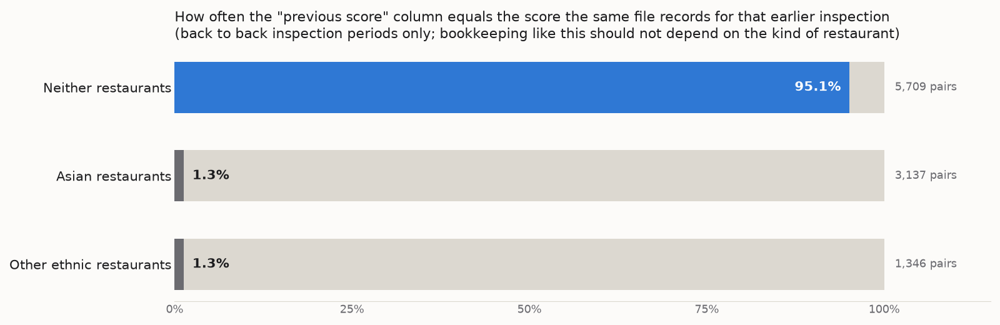

# Seattle food safety: the strongest predictor was a label the file contradicts

My take home assessment for the Stanford RegLab predoctoral Research Fellow
application, submitted on 30 September 2026. The task: predict which Seattle
restaurant inspections find a serious food safety violation, using only what is
known before the inspection, add flags for Asian and ethnic cuisines, and say
whether a health department should use the result.

[`tanay_singh_reglab_takehome.ipynb`](tanay_singh_reglab_takehome.ipynb) is the
notebook I submitted, unchanged, with every output from its one run saved.
Every number below was printed by a cell of that notebook.
[RESULTS.md](RESULTS.md) maps each one to its cell, and
`scripts/check_results.py` checks that mapping in CI.

## In one paragraph

Adding the cuisine flags appears to give the best model in the file. It does
not hold up. For Asian and Other ethnic restaurants, the file's own "previous
score" column agrees with the earlier score it records in 1.3% of back to back
inspections, against 95.1% for every other restaurant, and their scores do not
persist from one inspection to the next. Those rows behave like random numbers
centered near 60, so most of the headline test AUC of 0.886 comes from a label
problem. On the restaurants whose records look sound, the best model reaches an
AUC of 0.657, against 0.639 for ranking by the last inspection score.
Inspection history does almost all the work, Yelp adds nothing, and the model
as trained would send every priority inspection to Asian and Other ethnic
restaurants.

## The data

13,299 inspections of 1,756 restaurants, January 2006 to February 2013. Each
row is one inspection: its penalty score, the previous score, an average of
earlier scores, the Yelp reviews posted since the last inspection, the zip code
and the restaurant's Yelp cuisine labels. An inspection is serious if it scores
10 or more. Two rows carry a -1 placeholder and are dropped, leaving 13,297.

- **The cutoff sits low.** 67.4% of inspections are serious and 21.7% score
  exactly 0, so "serious" separates the cleanest third from everyone else.
  Always guessing serious is already 67.6% accurate on the test years, so I
  report AUC and precision among the riskiest 20% instead of accuracy.
- **Scores stick to restaurants.** The correlation with the previous score is
  0.707, and which restaurant it is explains 75.1% of the variance in scores.
  After a clean previous inspection 30.8% of inspections are serious; after a
  previous score of 50 or more, 97.4% are. So the evaluation splits by time and
  resamples whole restaurants.
- **Yelp barely moves.** The score's correlations with review count,
  non positive reviews and rating are all between -0.040 and 0. This matches
  Altenburger and Ho (2019), who found that Yelp adds little to the Seattle
  data behind Kang et al. (2013) once inspection history is known.

## Finding 1: the flagged rows do not behave like inspection records

A restaurant is Asian if any of its cuisine labels is Asian in the lookup, and
ethnic likewise. Every Asian cuisine is also coded ethnic, so I use three
groups: Asian (499 restaurants), Other ethnic (234) and Neither (1,022). These
are cuisine categories, not the owners' ethnicity.

Asian and Other ethnic restaurants average about 60 points, and 99.5% and 99.4%
of their inspections are serious. Neither restaurants average 10 points, and
42.2% are serious. That gap is bigger than real differences between kitchens
should produce, so before modeling I checked whether the two sets of rows behave
like the same kind of record.



- **The file disagrees with itself for two groups only.** When an inspection
  period starts on the day the previous one ended, the "previous score" column
  should equal the score the file records for that earlier inspection. It does
  in 95.1% of Neither pairs and 1.3% of Asian and Other ethnic pairs, and the
  gap holds at every score level.
- **Only the Neither scores bunch.** Neither scores land on multiples of 5 far
  more often than chance. Above 20, Asian and Other ethnic scores land on them
  only 19% to 26% of the time.
- **Only the Neither scores persist.** For Neither restaurants a score tracks
  the same restaurant's earlier score (correlation 0.245), and the "previous
  score" column tracks that earlier score closely (0.921). For the other two
  groups every one of these correlations is between -0.066 and 0.002.

Biased inspectors could make a group's scores higher and noisier, but they could
not make the file's own columns disagree with each other. The flagged rows look
as if their scores had been replaced with random numbers centered near 60. The
file cannot say where that happened: in the original records, in processing, or
in preparing the exercise. Comparing a sample of rows with King County's public
inspection records would settle it.

## Finding 2: on the sound records, history is nearly everything

I train on 2006 to 2010, choose settings and calibrate on 2011, and test once on
2012 to February 2013 (3,666 inspections), which is how a department would use
it. The intervals are 95% intervals from 500 bootstrap resamples of whole
restaurants, since a restaurant's inspections are related.


| Ranking | Test AUC, all | Test AUC, Neither [95% interval] | Precision in riskiest 20%, Neither |
|---|---|---|---|
| Previous score | 0.870 | 0.639 [0.613, 0.662] | 0.594 |
| Cuisine flag only | 0.836 | 0.500 | 0.418 |
| Logistic regression | 0.885 | 0.651 [0.626, 0.677] | 0.594 |
| Gradient boosting | 0.886 | 0.657 [0.631, 0.684] | 0.617 |
| Review text (TF-IDF, logistic) | 0.845 | 0.576 [0.549, 0.603] | 0.489 |

Random targeting finds a serious violation in 40.5% of Neither inspections.

- **Most of the headline AUC is the flag.** Over all inspections the cuisine
  flag alone gets 0.836. Boosting adds 0.016 to ranking by the last score.
  Boosting even gives every Asian and Other ethnic test inspection the same
  probability (0.953), so their order among themselves is a random tie break.
- **Within Neither the gain is modest.** Boosting beats the last score by 0.018,
  and the intervals overlap. Logistic regression and boosting are tied.
- **History alone does as well as everything.** Refit on one input group at a
  time, boosting on history alone gets 0.894 overall and 0.685 within Neither.
  Yelp alone gets 0.515, a coin flip. Dropping the cuisine flags changes
  nothing (0.889 and 0.671).
- **The text model is a cuisine detector.** The words pushing it toward serious
  are rice, sushi, mexican, pho, chinese, teriyaki and thai. The words pushing
  it away are pizza, subway, burger, sandwich and pie.

## Finding 3: the model would send every priority visit to two groups

Isotonic calibration fitted on 2011 makes the predicted risks usable as
probabilities without changing the ranking. Within Neither the Brier score goes
from 0.228 to 0.224, against 0.241 for the 2011 base rate. The targeting
problem is unchanged.


With a budget of 20% of test inspections, following the model sends all 733
visits to Asian and Other ethnic restaurants and none to Neither restaurants,
although 40.5% of Neither inspections are serious. Dropping the cuisine flags
does not help: the model still fills 99.7% of its riskiest 20% with those
restaurants, because their history columns are inflated too. Taking the riskiest
20% within each group finds 580 serious violations instead of 730. That loss
only counts if the flagged labels are real, and Finding 1 says they are not.

Predicting the score itself with a Poisson boosting model misses by 12.7 points
on average, against 15.9 for "same as last time", but it ranks inspections
almost exactly as the classifier does.

## What I would tell a health department

A model like this could reasonably move some routine visits from reliably clean
places to places with bad recent histories. Trained on these labels, it would
send every priority inspection to Asian and ethnic restaurants and none to the
rest. If labels like these come from inspector bias, the model hands that bias
back to inspectors and makes it look objective, and it feeds itself, since more
inspections mean more recorded violations. Targeting by cuisine comes close to
targeting by national origin. Before using it I would want a random share of
inspections, regular checks by group and by inspector, and caps on how far any
group's inspection rate can move until someone verifies the gap.

## Limitations

- Everything depends on the Asian and Other ethnic labels, so checking this file
  against the source records comes first.
- The test is offline. It assumes the inspections a department skips would have
  turned out the same, and it covers one period. Rolling the split forward a
  year at a time would show how stable this is.
- Both approaches predict where violations will be found, not where an
  inspection would reduce them. That needs random audits or an experiment.
- Training stops at 2010 so that 2011 could be used for tuning and calibration.
  In practice I would refit on everything.

## Running it

The data is not in this repository. `food_violations_seattle.csv` and
`cuisines.csv` were provided by RegLab for the exercise, so I have not
redistributed them. With Python 3.12, run `pip install -r requirements.txt`
(plus `pip install notebook` if you need Jupyter), put both files in a `data/`
folder next to the notebook, and run all cells. It takes under a minute.

Without the data, the two scripts still work, because they read the outputs
saved in the notebook rather than the CSVs:

```bash
python scripts/check_results.py      # every number in RESULTS.md is in the cell it cites
python scripts/portfolio_charts.py   # redraws the three figures from those outputs
```

## What is here

| Path | What it is |
|---|---|
| `tanay_singh_reglab_takehome.ipynb` | The submitted analysis, already run |
| `tanay_singh_reglab_takehome.html` | The same notebook as a web page, as submitted |
| `requirements.txt` | The pinned packages it ran with |
| `RESULTS.md` | Every quoted number, with the cell that printed it |
| `scripts/check_results.py` | Checks RESULTS.md against the notebook (standard library only) |
| `scripts/portfolio_charts.py` | Draws `figures/` from the notebook's saved outputs |
